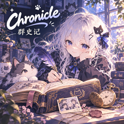
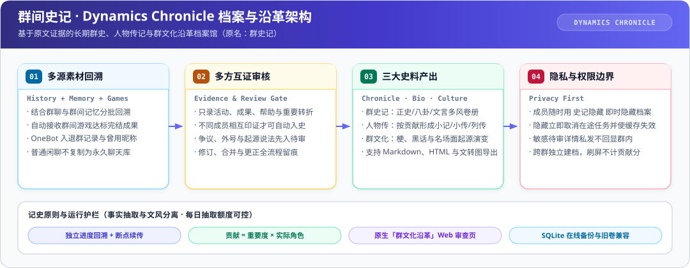

# 群间史记 · Dynamics Chronicle

**群间系列长期群史与文化档案插件（原名「群史记」）：以原文为据编撰群史卷册、人物传记与群梗沿革。**

[核心能力](#核心能力) · [快速开始](#快速开始) · [常用指令](#常用指令) · [群间系列生态](#群间系列生态) · [文档与许可](#进阶文档与许可)

---

## 核心能力

- **长期群史与多方互证审核**：结合群聊记录与群间记忆按批回溯历史，只收录活动、成果、重要帮助、共同项目、群文化、转折与经审核争议；普通闲聊与刷屏不入史。自动入史要求明确身份与不同成员相互印证，事实抽取与最终成文风格（正史 / 八卦 / 文言）分离，修订与合并全程审计留痕。
- **成员生涯与三阶人物传记**：跟踪入退群时期与曾用昵称，按 **贡献 = 事件重要度（1~3）× 实际角色（1~3）** 计算长期档案，刷屏与发言量不加分，自动形成 **小记（人人建档，300 字）→ 小传（1,000 字）→ 列传（3,000 字）** 三阶传记。
- **群文化沿革与梗溯源**：开启 `culture_enabled` 后，以原文为依据整理群梗、黑话、外号与名场面的含义、起源与演变；普通词义需两名独立成员支持才自动公开，起源说法与外号须经「群文化沿革」Web 管理页审核。
- **隐私优先与即时隐藏**：不把普通聊天复制为永久聊天库；任何成员随时可发送 `史记隐藏` 立即隐藏本人档案或相关事件，同步取消在途任务并使缓存失效，敏感待审详情仅私发不回显群内。

## 快速开始

1. 在 AstrBot（`>=4.29.4,<5`，Python 3.12+）安装本插件，并在设置中选择**普通聊天 LLM**（不使用 System One 等决策型 Provider）。
2. 在目标群发送 `史记sid` 获取完整 UMO，配置 `history_enabled=true`、`history_allow_groups` / `history_block_groups` 以及每日抽取额度；如需梗溯源与审查面板，另行开启 `culture_enabled`。
3. 搭配 **群间记忆** 可自动回溯历史留存消息，搭配 **群间游戏** 可自动收录达标的完结活动成果；无长期记忆时仍支持成员基础观察与人工 `记一笔`。

## 常用指令

| 场景 | 常用命令 |
| --- | --- |
| **查询与阅读** | `群大事 [全部/月/年/天数]` · `人物等级 [@成员]` · `人物传 @成员` · `群史记 [月/年] [风格=文言]` · `史记列表` · `史记查看` · `史记导出` · `史记网页` |
| **记事与审核** | `记一笔 标题｜经过与结果｜日期=YYYY-MM-DD` · `史记待审 [ID]` · `史记确认/史记驳回 ID` · `史记修订 ID 新经过｜说明=理由` · `史记合并 保留ID 被合并ID` · `史记更正 ID 建议` |
| **群文化沿革** | `/群文化` · `/梗溯源` · `/文化纠正` · `/文化隐藏`（及 Web「群文化沿革」面板） |
| **隐私与运维** | `史记隐藏` · `史记隐藏 事件ID` · `史记进度` · `史记续写` · `史记sid` |

---

## 群间系列生态

| 插件 | 仓库与标识 | 核心定位 |
| --- | --- | --- |
| **群间 · Chat Dynamics** | [`astrbot_plugin_chat_dynamics`](https://github.com/ysyhlly/astrbot_plugin_chat_dynamics) | 核心对话调度层：碎发聚合、话题路由、参与决策与节奏交付 |
| **群间世界 · Dynamics World** | [`astrbot_plugin_dynamics_world`](https://github.com/ysyhlly/astrbot_plugin_dynamics_world) | 角色卡、世界书、双地图天气、持续生活与 3D 实况小屋 |
| **群间记忆 · Dynamics Memory** | [`astrbot_plugin_dynamics_memory`](https://github.com/ysyhlly/astrbot_plugin_dynamics_memory) | 长期记忆、混合召回、2D/3D 图谱与原文证据冲突审查 |
| **群间学习 · Dynamics Learning** | [`astrbot_plugin_dynamics_learning`](https://github.com/ysyhlly/astrbot_plugin_dynamics_learning) | 固定性格红线下的成员资料、黑话好感与可回滚审查学习 |
| **群间见闻 · Dynamics Horizons** | [`astrbot_plugin_dynamics_horizons`](https://github.com/ysyhlly/astrbot_plugin_dynamics_horizons) | 角色隔离外部信息源与书架、自主精读与分群待讨论话题 |
| **群间游戏 · Dynamics Games** | [`astrbot_plugin_dynamics_games`](https://github.com/ysyhlly/astrbot_plugin_dynamics_games) | 共读/约局/接龙/挑战/共创协作与四大群聊娱乐引擎 |
| **群间史记 · Dynamics Chronicle**（当前） | [`astrbot_plugin_group_chronicle`](https://github.com/ysyhlly/astrbot_plugin_group_chronicle) | 原文依据的长期群史卷册、人物传记与群文化梗沿革 |
| **群间视觉 · Visual Media** | [`astrbot_plugin_visual_media`](https://github.com/ysyhlly/astrbot_plugin_visual_media) | 表情收集检索、多模态生图改图与角色视觉形象管理 |

---

## 进阶文档与许可

- [发布说明与验证边界](RELEASE_NOTES.md) · [更新日志](CHANGELOG.md) · [群文化使用与接口](CULTURE.md) · [升级与迁移说明](MIGRATION.md)
- 交流与反馈：项目反馈群兼聊天群 QQ `203363132`
- 本项目遵循 [AGPL-3.0 License](LICENSE)。
